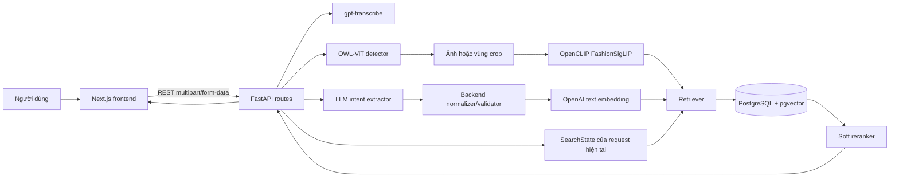
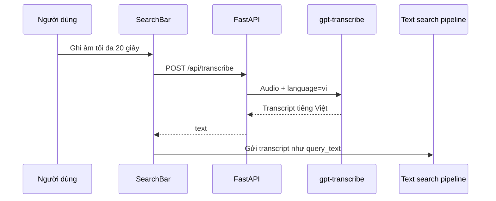

# Hệ thống tìm kiếm thời trang đa phương thức

Ứng dụng tìm kiếm sản phẩm thời trang bằng **văn bản**, **giọng nói** và **hình ảnh**. Hệ thống có thể tách điều kiện từ câu tiếng Việt, tìm sản phẩm bằng vector, lọc theo thuộc tính và giải thích ngắn gọn vì sao một sản phẩm được trả về.

README này mô tả mã nguồn đang chạy trong repository. Nếu bạn mới học dự án, hãy đọc lần lượt các phần **Kiến trúc**, **Luồng hoạt động**, **Vai trò từng file** và **Thứ tự đọc code đề xuất**.

## Mục lục

- [Chức năng chính](#chức-năng-chính)
- [Công nghệ và mô hình](#công-nghệ-và-mô-hình)
- [Kiến trúc tổng thể](#kiến-trúc-tổng-thể)
- [Luồng hoạt động](#luồng-hoạt-động)
- [Cấu trúc mã nguồn](#cấu-trúc-mã-nguồn)
- [Cơ chế tìm kiếm và xếp hạng](#cơ-chế-tìm-kiếm-và-xếp-hạng)
- [Cơ sở dữ liệu](#cơ-sở-dữ-liệu)
- [API](#api)
- [Cài đặt và chạy dự án](#cài-đặt-và-chạy-dự-án)
- [Nạp dữ liệu và tạo embedding](#nạp-dữ-liệu-và-tạo-embedding)
- [Kiểm thử](#kiểm-thử)
- [Cách đọc và học code](#cách-đọc-và-học-code)
- [Giới hạn hiện tại](#giới-hạn-hiện-tại)
- [Xử lý lỗi thường gặp](#xử-lý-lỗi-thường-gặp)

## Chức năng chính

- Tìm kiếm bằng câu tiếng Việt, ví dụ: `Tìm quần short màu trắng dưới 1 triệu`.
- Ghi âm tối đa 20 giây, chuyển giọng nói tiếng Việt thành văn bản rồi tìm kiếm.
- Tải ảnh outfit hoặc ảnh sản phẩm, tự phát hiện vùng áo, quần, váy hoặc giày.
- Chọn một bounding box khi ảnh có nhiều vật thể.
- Kết hợp ảnh với mô tả, ví dụ: tải ảnh quần đen và nhập `quần này màu trắng dưới 1 triệu`.
- Mỗi lần tìm kiếm là một request độc lập; ảnh và mô tả có thể được gửi cùng một lần.
- Tìm sản phẩm tương tự từ một thẻ sản phẩm.
- Phân biệt câu tìm kiếm sản phẩm với câu trò chuyện thông thường.
- Tìm kiếm vector bằng PostgreSQL và `pgvector`, sau đó xếp hạng lại bằng nhiều tín hiệu.

## Công nghệ và mô hình

| Thành phần | Công nghệ / mô hình | Vai trò |
|---|---|---|
| Frontend | Next.js 16, React 19, TypeScript, Tailwind CSS 4 | Giao diện tìm kiếm và hiển thị kết quả |
| Backend | FastAPI, Uvicorn, Pydantic | REST API, validation và điều phối pipeline |
| Cơ sở dữ liệu | PostgreSQL 16, pgvector | Lưu sản phẩm, lịch sử truy vấn và vector 768 chiều |
| Hiểu ý định | `gpt-4o-mini` | Chuyển câu tự nhiên thành JSON có cấu trúc |
| Dự phòng intent | Gemini, sau đó rule-based parser | Dùng khi provider trước không khả dụng |
| Speech-to-Text | OpenAI `gpt-transcribe` | Nhận dạng giọng nói tiếng Việt |
| Phát hiện vật thể | `google/owlvit-base-patch32` | Tìm và khoanh vùng loại vật thể thời trang ở mức khái quát |
| Embedding ảnh | `hf-hub:Marqo/marqo-fashionSigLIP` | Biểu diễn ảnh/crop để tìm ảnh sản phẩm tương tự |
| Embedding văn bản | OpenAI `text-embedding-3-small`, 768 chiều | Biểu diễn truy vấn và mô tả sản phẩm |

OWL-ViT và FashionSigLIP làm hai việc khác nhau:

- **OWL-ViT** trả lời “vật thể nằm ở đâu trong ảnh?” và sinh bounding box.
- **FashionSigLIP** trả lời “hình ảnh này giống sản phẩm nào trong catalog?”.

Embedding ảnh và embedding văn bản được lưu ở hai cột riêng. Truy vấn text/voice tìm trên `text_embedding`; truy vấn ảnh tìm trên `image_embedding`.

## Kiến trúc tổng thể



Backend giữ trách nhiệm chính về nghiệp vụ. Frontend thu thập input, gọi API và render dữ liệu mà backend trả về. Các schema Pydantic và TypeScript là hợp đồng giữa hai phía.

## Luồng hoạt động

### 1. Tìm bằng văn bản

Ví dụ: `Tìm quần short màu trắng dưới 1 triệu`.

1. `SearchBar.tsx` gửi `query_text` tới `POST /api/search`.
2. `IntentExtractor` gọi LLM và nhận JSON dự kiến như:

   ```json
   {
     "intent_type": "product_search",
     "category": "Shorts",
     "color": "White",
     "max_price": 1000000
   }
   ```

3. `EntityNormalizer` và `_reconcile_intent()` kiểm tra lại các trường quan trọng bằng từ xuất hiện thật trong câu. Tầng này ngăn trường hợp LLM tự suy diễn màu hoặc danh mục không có trong input.
4. Backend tạo `SearchState` mới chỉ từ intent của request hiện tại.
5. Câu gốc được biến thành vector bằng `text-embedding-3-small`.
6. `ProductRetriever` áp dụng bộ lọc metadata và tìm trên `product.text_embedding`.
7. Nếu câu gốc không sinh được ứng viên, backend tạo **canonical query** từ JSON intent, ví dụ `shorts, white`, rồi thử tìm lần nữa.
8. `SoftReranker` tính điểm cuối, thêm lý do khớp và trả response cho frontend.

Thiết kế hiện tại dùng câu gốc trước để giữ đủ ngữ nghĩa. Canonical query chỉ là fallback khi lượt tìm đầu không có ứng viên.

### 2. Tìm bằng giọng nói



Sau bước phiên âm, truy vấn đi qua cùng pipeline với tìm kiếm văn bản. Vì vậy chất lượng cuối phụ thuộc cả STT, tách intent, dữ liệu catalog và retrieval.

### 3. Tìm bằng hình ảnh

1. Frontend gửi ảnh tới `POST /api/detect`.
2. OWL-ViT tìm các vùng khái quát: áo, quần, váy, đầm hoặc giày.
3. Người dùng có thể chọn một vùng. Frontend gửi ảnh cùng `crop_box` tới `POST /api/search`.
4. Backend crop ảnh, lưu bản crop vào `data/uploads/` và tạo vector FashionSigLIP.
5. Backend dùng các hàng xóm ảnh gần nhất trong database để suy ra danh mục catalog chi tiết hơn.
6. Retriever so sánh vector ảnh truy vấn với `product.image_embedding` bằng cosine distance của pgvector.

Nhãn và phần trăm ở bước OWL-ViT là **độ tin cậy phát hiện vùng**, không phải loại sản phẩm chi tiết và cũng không phải điểm giống sản phẩm.

### 4. Kết hợp ảnh và văn bản

Ảnh cung cấp hình dáng/sản phẩm tham chiếu; text cung cấp điều kiện muốn thay đổi.

Ví dụ: ảnh là quần dài màu đen, text là `quần này màu trắng dưới 1 triệu`.

- Vector ảnh dùng để ưu tiên sản phẩm có hình dáng gần ảnh gốc.
- `White` và `max_price=1000000` trở thành điều kiện metadata.
- Khi text chỉ nói loại chung như `quần này`, backend để ảnh hỗ trợ suy ra loại cụ thể.
- Khi text nói rõ `quần short`, danh mục cụ thể từ text được quyền ghi đè.

Hệ thống hiện không cộng trực tiếp vector text và vector ảnh. Mỗi loại vector nằm trong không gian riêng; kết quả được kết hợp qua điều kiện metadata và reranking.

### 5. Các request độc lập

Backend không giữ session tìm kiếm và không kế thừa điều kiện từ request trước. Người dùng cần gửi đầy đủ yêu cầu trong một lần:

```text
Request 1: "Tìm áo sơ mi"
Request 2: "Tìm áo sơ mi màu trắng dưới 500 nghìn"
```

Khi dùng sidebar, frontend ghép toàn bộ category, màu và khoảng giá đang chọn thành một query hoàn chỉnh rồi gửi lại. Đây là trạng thái UI cục bộ, không phải multi-turn phía backend.

### 6. Câu trò chuyện

Với câu như `Xin chào, bạn có khỏe không?`, intent phải là `conversation`. Backend trả thông báo hội thoại và không chạy truy vấn trả về 50 sản phẩm ngẫu nhiên.

## Cấu trúc mã nguồn

```text
.
├── backend/                 FastAPI, AI pipeline, truy vấn database
│   ├── core/                Logic tìm kiếm chính
│   ├── db/                  Kết nối và schema PostgreSQL
│   ├── domain/              Domain model thuần Python
│   ├── routes/              REST endpoints
│   ├── schemas/             Pydantic request/response contracts
│   └── main.py              Điểm khởi động FastAPI
├── web/                     Next.js frontend
│   ├── src/app/             App Router và trang chính
│   ├── src/components/      Các component giao diện
│   ├── src/lib/             API client
│   ├── src/types/           TypeScript contracts
│   └── __tests__/           Test frontend
├── scripts/                 Chuẩn bị dữ liệu, index và benchmark
├── tests/                   Test backend
├── data/                    CSV, ảnh, embedding và ảnh upload
├── docs/                    Tài liệu kỹ thuật chi tiết
├── docker-compose.yml       PostgreSQL + pgvector
└── requirements.txt         Thư viện Python
```

### Backend

| File | Lưu gì / làm gì | Nên mở khi nào |
|---|---|---|
| `backend/main.py` | Khởi tạo FastAPI, CORS, exception handler, `/health`, mount `/images` và `/uploads` | Muốn hiểu backend bắt đầu ở đâu |
| `backend/routes/search_routes.py` | Điều phối request detect, transcribe, search và product detail | Muốn lần theo một request từ đầu đến cuối |
| `backend/core/extractor.py` | Prompt LLM, parse JSON intent, đối chiếu kết quả LLM và tạo canonical query | Muốn sửa cách hiểu câu người dùng |
| `backend/core/normalizer.py` | Từ điển/mapping danh mục, màu, giới tính, chất liệu, giá và biến thể tiếng Việt | Muốn bổ sung từ đồng nghĩa hoặc sửa mapping |
| `backend/core/detector.py` | Load OWL-ViT, prompt phát hiện vùng, hậu xử lý box và crop ảnh | Muốn sửa phát hiện vật thể trong outfit |
| `backend/core/embedder.py` | Singleton load FashionSigLIP; gọi OpenAI text embedding; chuẩn hóa vector | Muốn đổi model hoặc kiểm tra vector được tạo ra sao |
| `backend/core/retriever.py` | Sinh SQL hard filter, tìm pgvector, Phase 1/2 và CSV fallback | Muốn sửa logic sản phẩm nào được chọn |
| `backend/core/reranker.py` | Tính `final_score`, sắp xếp lại ứng viên và tạo explanation badges | Muốn sửa thứ tự hiển thị |
| `backend/core/search_audit.py` | Ghi một search request và kết quả đã hiển thị vào các bảng audit | Muốn sửa lịch sử tìm kiếm |
| `backend/core/transcriber.py` | Gửi audio tới OpenAI `gpt-transcribe`, ngôn ngữ `vi` | Muốn sửa Speech-to-Text |
| `backend/schemas/state.py` | `QueryIntent`, `SearchState`, `SearchResultItem`, `SearchResponse` | Muốn biết dữ liệu đi giữa các tầng |
| `backend/schemas/api.py` | Schema detect, transcription, product detail và lỗi | Muốn xem hợp đồng API còn lại |
| `backend/db/connection.py` | Đọc biến PostgreSQL và cung cấp context manager kết nối | Muốn sửa cấu hình database |
| `backend/db/schema.sql` | 14 bảng, khóa ngoại, pgvector và HNSW index | Muốn học cấu trúc dữ liệu |
| `backend/domain/models.py` | Các dataclass/domain model độc lập framework | Muốn hiểu thực thể nghiệp vụ |

### Frontend

| File | Vai trò |
|---|---|
| `web/src/app/page.tsx` | Trang điều phối chính: state UI, gọi search/detect/transcribe và xử lý kết quả |
| `web/src/app/layout.tsx` | Root layout của Next.js |
| `web/src/app/globals.css` | Style toàn cục và Tailwind |
| `web/src/lib/api.ts` | Tất cả lệnh `fetch` tới backend và xử lý lỗi API |
| `web/src/types/search.ts` | TypeScript interface tương ứng schema Pydantic |
| `web/src/components/SearchBar.tsx` | Nhập text, chọn ảnh, ghi âm tối đa 20 giây |
| `web/src/components/ImageAnalysisBar.tsx` | Trạng thái phân tích ảnh và vật thể đang chọn |
| `web/src/components/ObjectSelectModal.tsx` | Vẽ box/polygon và cho chọn đúng vật thể |
| `web/src/components/ProductGrid.tsx` | Chia và render exact/similar/conversation results |
| `web/src/components/ProductCard.tsx` | Thẻ sản phẩm, điểm khớp ảnh và nút tìm tương tự |
| `web/src/components/FacetSidebar.tsx` | Bộ lọc danh mục, màu và giá |
| `web/src/components/RecommendedPills.tsx` | Câu truy vấn gợi ý |
| `web/src/components/Header.tsx` | Header giao diện |

### Dữ liệu và scripts

| Đường dẫn | Vai trò |
|---|---|
| `data/images/` | Ảnh catalog được backend phục vụ qua `/images` |
| `data/uploads/` | Ảnh/crop truy vấn do người dùng tải lên |
| `data/sample_articles.csv` | Dataset mẫu nhỏ 30 dòng; đây cũng là đường dẫn mặc định của script index |
| `data/data/sample_articles.csv` | Dataset 1.000 sản phẩm đang có trong workspace |
| `data/data/images/` | 1.000 ảnh đi cùng dataset trên |
| `data/data/embeddings.npz` | Vector đã tính trước để tái sử dụng |
| `scripts/index_products.py` | Tạo embedding và upsert category/product vào PostgreSQL |
| `scripts/sample_dataset.py` | Lấy mẫu phân tầng từ dữ liệu H&M hoặc tạo mock data |
| `scripts/extract_1000_apparel.py` | Trích bộ 1.000 sản phẩm apparel |
| `scripts/migrate_to_14_classes.py` | Migration dữ liệu/schema liên quan taxonomy |
| `scripts/benchmark_e2e.py` | Chạy benchmark pipeline đầu cuối |

> Hai file CSV có kích thước khác nhau. Khi index dữ liệu thật 1.000 sản phẩm, phải truyền rõ `--csv data/data/sample_articles.csv` và `--images-dir data/data/images`; nếu bỏ tham số, script dùng bộ 30 dòng.

## Cơ chế tìm kiếm và xếp hạng

### Hard filter

`ProductRetriever` xây điều kiện SQL từ `SearchState`:

- Danh mục cụ thể: so khớp `sub_category`.
- `Pants`: nhóm ảo gồm `Trousers` và `Shorts`.
- Danh mục tổng quát như `Garment Upper body`: so khớp `group_name`.
- Màu, giới tính và khoảng giá: điều kiện metadata.
- Màu/chất liệu loại trừ: điều kiện phủ định hoặc penalty tùy trường.

Vì danh mục là điều kiện ưu tiên cao, truy vấn `quần màu hồng` không được nới thành giày màu hồng.

### Phase 1: exact constraints

Hệ thống giữ các điều kiện người dùng đã nói và lấy tối đa các sản phẩm thỏa metadata. Nếu có vector, các sản phẩm được sắp theo cosine similarity.

Từ `exact` ở đây nghĩa là **khớp điều kiện có cấu trúc**, không có nghĩa ảnh giống 100%.

### Phase 2: controlled relaxation

Chỉ chạy khi Phase 1 không có sản phẩm. Phase 2 giữ danh mục và nới một số điều kiện thứ cấp theo cách có kiểm soát, đồng thời yêu cầu ngưỡng vector:

- Text/voice: mặc định `0.58`.
- Image: mặc định `0.65`.

Các ngưỡng trên hiện là giá trị mặc định trong `ProductRetriever`; các biến `THRESHOLD_TEXT` và `THRESHOLD_IMAGE` trong `.env` chưa được code đọc.

### Reranking

Điểm cuối hiện được tính theo công thức:

```text
final_score = 0.45 × vector_similarity
            + 0.25 × text_description_score
            + 0.15 × color_score
            + 0.15 × price_score
            + material_bonus
            - violation_penalty
```

Trong model dữ liệu, trường `visual_similarity` đang chứa độ tương đồng vector chung. Với query text, đó là text similarity; với query ảnh, đó mới là image similarity. Frontend chỉ hiện nhãn `% khớp ảnh` khi response có `query_type=image`.

## Cơ sở dữ liệu

`backend/db/schema.sql` tạo extension `vector` và 14 bảng:

- Catalog: `category`, `product`.
- Người dùng và tìm kiếm: `customer`, `search_query`, `text_query`, `image_query`, `voice_query`, `search_result`.
- Thương mại: `cart`, `cart_item`, `order`, `order_item`, `payment`, `shipment`.

Bảng `product` chứa metadata, đường dẫn ảnh và hai vector:

```text
image_embedding vector(768)  -> FashionSigLIP
text_embedding  vector(768)  -> text-embedding-3-small theo cấu hình mặc định
```

Hai HNSW index hỗ trợ tìm cosine nhanh trên hai cột. Toán tử pgvector `<=>` trả cosine distance; code chuyển nó thành similarity để xếp hạng.

## API

Base URL mặc định: `http://127.0.0.1:8000`.

| Method | Endpoint | Chức năng |
|---|---|---|
| `GET` | `/health` | Kiểm tra backend còn hoạt động |
| `POST` | `/api/detect` | Nhận file ảnh, trả danh sách bounding box |
| `POST` | `/api/transcribe` | Nhận audio, trả transcript tiếng Việt |
| `POST` | `/api/search` | Tìm text, image, image+text hoặc theo sản phẩm tham chiếu |
| `GET` | `/api/products/{product_id}` | Lấy chi tiết một sản phẩm |

FastAPI tự sinh giao diện thử API tại:

```text
http://127.0.0.1:8000/docs
```

`POST /api/search` nhận `multipart/form-data` với các trường chính:

| Trường | Ý nghĩa |
|---|---|
| `query_text` | Yêu cầu đầy đủ của lần tìm kiếm hiện tại |
| `reference_article_id` | ID sản phẩm dùng để tìm tương tự |
| `image` | File ảnh |
| `crop_box` | JSON `[ymin, xmin, ymax, xmax]`, tọa độ chuẩn hóa 0–1 |
| `query_type` | `text`, `image` hoặc `voice` khi client cần chỉ rõ nguồn |

## Cài đặt và chạy dự án

Các lệnh dưới đây dùng cho **Windows CMD**.

### 1. Tạo môi trường Python

```cmd
cd /d D:\HTTT-THẦY\_QUẾ
python -m venv .venv
.venv\Scripts\activate
python -m pip install --upgrade pip
pip install -r requirements.txt
```

### 2. Tạo `.env`

Tạo file `.env` ở thư mục gốc. Không commit API key lên Git.

```dotenv
POSTGRES_HOST=localhost
POSTGRES_PORT=5434
POSTGRES_USER=postgres
POSTGRES_PASSWORD=postgres
POSTGRES_DB=fashion_search
POSTGRES_CONNECT_TIMEOUT=2

OPENAI_API_KEY=thay_bang_api_key_cua_ban
GEMINI_API_KEY=
LOCAL_TEXT_EMBEDDING=0
DATA_IMAGES_DIR=data/images
```

`OPENAI_API_KEY` đang được dùng cho intent, text embedding và Speech-to-Text. `GEMINI_API_KEY` là fallback cho intent. Đặt `LOCAL_TEXT_EMBEDDING=1` nếu chủ động muốn dùng text encoder local, nhưng catalog và query phải được index bằng cùng cấu hình.

### 3. Chạy PostgreSQL bằng Docker

Mở Docker Desktop trước, sau đó:

```cmd
cd /d D:\HTTT-THẦY\_QUẾ
docker compose up -d
docker compose ps
```

Container dùng cổng host `5434` theo cấu hình mặc định.

### 4. Chạy backend

Ở cửa sổ CMD thứ nhất:

```cmd
cd /d D:\HTTT-THẦY\_QUẾ
.venv\Scripts\activate
python -m uvicorn backend.main:app --host 127.0.0.1 --port 8000 --reload
```

Lần đầu chạy, không đặt `HF_HUB_OFFLINE=1` để Hugging Face có thể tải OWL-ViT và FashionSigLIP. Sau khi model đã có trong cache, có thể chạy offline:

```cmd
set HF_HUB_OFFLINE=1
python -m uvicorn backend.main:app --host 127.0.0.1 --port 8000 --reload
```

### 5. Chạy frontend

Ở cửa sổ CMD thứ hai:

```cmd
cd /d D:\HTTT-THẦY\_QUẾ\web
npm install
npm.cmd run dev
```

Mở:

- Frontend: `http://localhost:3000`
- Backend health: `http://127.0.0.1:8000/health`
- Swagger: `http://127.0.0.1:8000/docs`

Nếu backend chạy ở URL khác, tạo `web/.env.local`:

```dotenv
NEXT_PUBLIC_API_URL=http://127.0.0.1:8001
```

## Nạp dữ liệu và tạo embedding

Schema chỉ tự tạo khi volume PostgreSQL được khởi tạo lần đầu. Sau khi database chạy, index bộ 1.000 sản phẩm bằng:

```cmd
cd /d D:\HTTT-THẦY\_QUẾ
.venv\Scripts\activate
python scripts\index_products.py --csv data\data\sample_articles.csv --images-dir data\data\images --save-embeddings data\data\embeddings.npz
```

Nếu đã có file embedding tương thích và muốn tránh tính lại:

```cmd
python scripts\index_products.py --csv data\data\sample_articles.csv --images-dir data\data\images --load-embeddings data\data\embeddings.npz
```

Điều kiện quan trọng: vector lúc index và vector lúc query phải do cùng model/cùng cấu hình sinh ra. Không trộn catalog index bằng local text encoder với query dùng OpenAI embedding.

Để xem toàn bộ tùy chọn:

```cmd
python scripts\index_products.py --help
```

## Kiểm thử

### Backend

```cmd
cd /d D:\HTTT-THẦY\_QUẾ
.venv\Scripts\activate
python -m pytest -q
```

Các nhóm test:

| File | Phạm vi |
|---|---|
| `tests/test_domain_models.py` | Domain model và dữ liệu cơ bản |
| `tests/test_phase1_db_and_index.py` | Schema, DB và indexing |
| `tests/test_phase2_core_engine.py` | Normalizer, extractor, retriever và reranker |
| `tests/test_phase3_api.py` | Contract và hành vi REST API |
| `tests/test_phase5_e2e.py` | Kịch bản pipeline đầu cuối |

Một số test dùng mock để chạy ổn định và không gọi API/model thật. Vì vậy sau unit test vẫn cần manual test với database, API key và model thật.

### Frontend

```cmd
cd /d D:\HTTT-THẦY\_QUẾ\web
npm.cmd test -- --runInBand
npx.cmd tsc --noEmit
npm.cmd run build
```

### Bộ câu test tay đề xuất

| Mục tiêu | Input | Kỳ vọng chính |
|---|---|---|
| Danh mục + màu | `Tìm quần màu hồng` | Chỉ Trousers/Shorts, không trả giày hồng |
| Danh mục cụ thể | `Tìm quần short màu trắng dưới 1 triệu` | `category=Shorts`, `color=White`, đúng giá |
| Giá chính xác | `Tìm áo sơ mi có giá 199.000 đồng` | Không hiểu từ “đồng” là màu đồng |
| Phủ định | `Tìm áo đen nhưng không phải len` | Có `exclude_materials`, tránh sản phẩm len |
| Hội thoại | `Xin chào, bạn có khỏe không?` | Không trả danh sách sản phẩm |
| Voice | Nói `Tìm áo sơ mi trắng dưới năm trăm nghìn` | Transcript và intent đúng tiếng Việt |
| Một vật thể | Upload ảnh một chiếc quần | Tìm theo crop/toàn ảnh, query type là image |
| Nhiều vật thể | Upload outfit có áo và quần | Hiện box để chọn đúng vật thể |
| Ảnh + text | Upload quần đen + `quần này màu trắng dưới 1 triệu` | Giữ hình dáng gần ảnh, lọc màu và giá |
| Request độc lập | `Tìm áo trắng dưới 500k` → `Tìm quần đen` | Request sau không giữ category/màu/giá của request trước |

Khi test, quan sát log `intent_extractor` để xem JSON intent, log `retriever` để biết Phase 1 hay Phase 2, và response trong tab Network để phân biệt `final_score`, `visual_similarity`, `match_type` và `query_type`.

## Cách đọc và học code

Một lộ trình ngắn để không bị ngợp:

1. Mở `backend/schemas/state.py` trước. Đây là “từ vựng” của hệ thống: intent, state và result.
2. Đọc `backend/routes/search_routes.py` từ hàm `search_products()`. Ghi lại cách mỗi request tạo `SearchState` mới và thứ tự các service được gọi.
3. Đi sâu vào `extractor.py` và `normalizer.py` để hiểu cách một câu tiếng Việt trở thành trường dữ liệu.
4. Đọc `retriever.py`, đối chiếu SQL với `backend/db/schema.sql`.
5. Đọc `reranker.py` và tự tính `final_score` cho một sản phẩm mẫu.
6. Với ảnh, đọc `detector.py` trước rồi `embedder.py`. Nhớ rằng detection và embedding là hai bước khác nhau.
7. Quay sang `web/src/lib/api.ts`, sau đó đọc `web/src/app/page.tsx` để xem frontend gọi các endpoint như thế nào.
8. Đọc test ngay sau file triển khai tương ứng; test cho biết hành vi nào được coi là đúng.

Khi muốn sửa một vấn đề, lần theo theo bảng sau:

| Hiện tượng | File kiểm tra đầu tiên |
|---|---|
| LLM tách sai màu/danh mục/giá | `extractor.py`, `normalizer.py` |
| Đúng intent nhưng trả sai loại sản phẩm | `retriever.py` và dữ liệu `category` trong DB |
| Kết quả đúng nhưng thứ tự chưa hợp lý | `reranker.py` |
| Box ảnh sai hoặc thiếu | `detector.py` |
| Ảnh tương tự chưa tốt | `embedder.py`, vector đã index và `retriever.py` |
| Voice nghe sai | `transcriber.py`, định dạng audio từ `SearchBar.tsx` |
| UI hiển thị sai badge/score | `ProductGrid.tsx`, `ProductCard.tsx`, `page.tsx` |
| Sidebar gửi sai điều kiện | `page.tsx`, `FacetSidebar.tsx`, `search_routes.py` |

### Một số khái niệm cần biết

- **Intent extraction:** biến câu tự nhiên thành JSON có cấu trúc.
- **Normalization:** đưa từ đồng nghĩa và cách nói khác nhau về một giá trị chuẩn.
- **Embedding:** vector số đại diện cho ý nghĩa văn bản hoặc nội dung ảnh.
- **Cosine similarity:** mức gần nhau về hướng giữa hai vector; càng cao thường càng tương đồng.
- **Hard filter:** điều kiện bắt buộc như danh mục hoặc giá.
- **Controlled relaxation:** nới một phần điều kiện khi không có exact result nhưng vẫn giữ ràng buộc cốt lõi.
- **Reranking:** chấm điểm lại danh sách ứng viên bằng nhiều tín hiệu.
- **Canonical query:** chuỗi tìm kiếm ngắn được ghép từ JSON intent chuẩn hóa.

## Giới hạn hiện tại

- LLM extraction đã có backend verification nhưng vẫn phụ thuộc độ phủ mapping trong `normalizer.py` và taxonomy catalog.
- Text search và image search dùng hai cột vector riêng; chưa có mô hình fusion học được trọng số giữa text và ảnh.
- Phase 2 dùng ngưỡng cố định trong code, chưa đọc `THRESHOLD_TEXT`/`THRESHOLD_IMAGE` từ `.env`.
- Nếu PostgreSQL lỗi, retriever có CSV fallback. Kết quả fallback có thể khác dữ liệu đang index trong DB.
- `embedder.py` có fallback local/mock để phục vụ phát triển. Cần kiểm tra log để tránh đánh giá chất lượng thật trên mock embedding.
- `detector.py` có fallback box khi không load được OWL-ViT. Box xuất hiện không luôn đồng nghĩa model thật đã chạy thành công.
- Tên trường `visual_similarity` được dùng chung cho similarity của truy vấn text và ảnh; cần đọc `query_type` để diễn giải đúng.
- CORS hiện cho phép mọi origin, phù hợp phát triển local nhưng cần giới hạn khi triển khai thật.

## Xử lý lỗi thường gặp

### Cổng 8000 đã được sử dụng

```text
[WinError 10048] only one usage of each socket address...
```

Kiểm tra tiến trình:

```cmd
netstat -ano | findstr :8000
tasklist /FI "PID eq <PID>"
```

Giữ server cũ hoặc chạy cổng khác:

```cmd
python -m uvicorn backend.main:app --host 127.0.0.1 --port 8001
```

Nếu đổi cổng, cập nhật `NEXT_PUBLIC_API_URL` ở frontend.

### Backend không kết nối được PostgreSQL

```cmd
docker compose ps
docker compose logs postgres
```

Đối chiếu `POSTGRES_PORT`, user, password và database trong `.env` với `docker-compose.yml`.

### Model Hugging Face không tải được

- Lần tải đầu cần mạng và không được bật `HF_HUB_OFFLINE=1`.
- Sau khi cache đầy đủ mới bật offline.
- Xem log có dòng `model initialized successfully` hay cảnh báo fallback.

### Có ảnh nhưng tìm ra 0 kết quả

Kiểm tra lần lượt:

1. Ảnh catalog và bản ghi product có khớp `article_id` không.
2. `image_embedding` trong DB có null không.
3. Catalog và query có được encode bằng cùng FashionSigLIP không.
4. Category được suy ra có làm hard filter quá hẹp không.
5. Similarity có thấp hơn ngưỡng ảnh `0.65` không.

### Query text đúng nhưng không có kết quả

Kiểm tra log theo thứ tự:

1. JSON `Intent extracted` có đúng không.
2. `Intent category reconciled` đổi danh mục thành gì.
3. Phase 1 có bị lọc hết bởi category/color/price không.
4. Canonical fallback được tạo ra sao.
5. Catalog đã có `text_embedding` và cùng model với query chưa.

## Tài liệu chi tiết

- [Mục lục tài liệu](docs/README.md)
- [Kiến trúc ứng dụng](docs/01-technical/02-app-architecture.md)
- [Multimodal pipeline](docs/01-technical/03-multimodal-pipeline.md)
- [Đặc tả API](docs/03-specs/api-specs.md)
- [Database schema](docs/03-specs/database-schema.md)
- [Kịch bản test tay](docs/manual-search-test-plan.md)
- [Runbook vận hành](docs/runbook.md)

## Quy tắc khi phát triển

- Không commit `.env`, API key, virtual environment, model cache hoặc `node_modules`.
- Khi đổi Pydantic response schema, cập nhật đồng thời `web/src/types/search.ts`.
- Khi đổi model embedding, index lại toàn bộ vector tương ứng.
- Khi thêm taxonomy hoặc từ đồng nghĩa, bổ sung test cho `normalizer`, `extractor` và `retriever`.
- Chạy backend test, TypeScript check và frontend test trước khi push branch.
