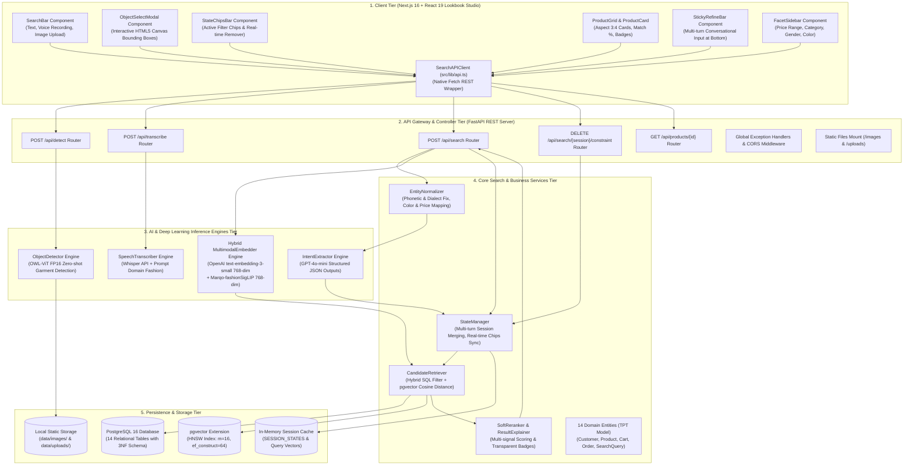
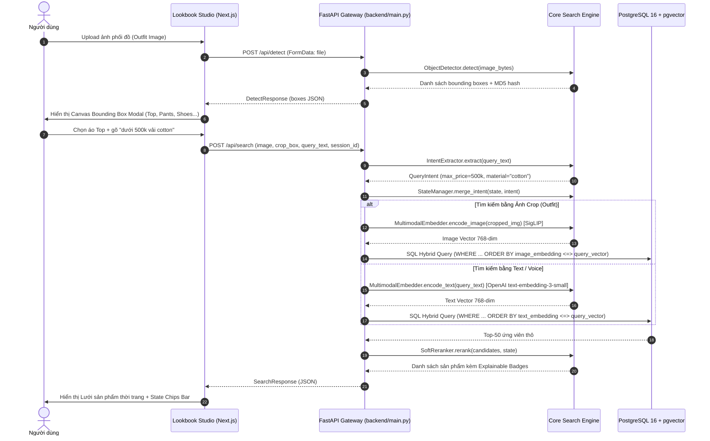

# Kiến Trúc Ứng Dụng Tổng Thể (App Architecture)

Tài liệu này thuyết minh toàn diện cách ứng dụng **Interactive Multimodal Shopping Search Engine** được thiết kế và vận hành, cấu trúc phân tầng Monorepo, chu trình khởi động của hệ thống, và luồng giao tiếp giữa các tầng.

---

## 1. Sơ đồ Kiến trúc 5 Tầng Tổng thể

Hệ thống được tổ chức theo kiến trúc 5 tầng chuẩn mực, phân tách rõ rệt giữa giao diện người dùng, cổng giao tiếp API, cỗ máy suy luận AI, logic nghiệp vụ tìm kiếm và hạ tầng CSDL:



---

## 2. Chu Trình Khởi Động & Lifecycle Của Hệ Thống

### 2.1. Chu trình khởi động Backend (`backend/main.py`)
1. **Nạp biến môi trường**: `load_dotenv()` nạp cấu hình từ `.env` (CSDL credentials, OpenAI API Key, cờ phần cứng).
2. **Khởi tạo FastAPI Application**: Khai báo tiêu đề, mô tả tài liệu OpenAPI và phiên bản hệ thống.
3. **Cấu hình CORS Middleware**: Cho phép giao diện Next.js (`http://localhost:3000`) gọi API không bị rào cản Cross-Origin.
4. **Đăng ký Exception Handlers**: Gắn `http_exception_handler` và `general_exception_handler` đảm bảo 100% phản hồi lỗi đều tuân thủ schema `ErrorResponse`.
5. **Mount Static Folders**: Mount thư mục `data/images` vào đường dẫn `/images` và `data/uploads` vào `/uploads`.
6. **Nạp Routes**: Gắn `search_router` vào tiền tố `/api`.
7. **Khởi tạo AI Model Singletons (Lazy/Eager Loading)**:
   - Khi server nhận request đầu tiên, các Singleton `ObjectDetector.get_instance()` và `MultimodalEmbedder.get_instance()` sẽ nạp trọng số mô hình vào VRAM của GPU NVIDIA GTX 1660 Ti một lần duy nhất.

### 2.2. Chu trình khởi động Frontend (`web/src/app/page.tsx`)
1. **Khởi tạo Root Layout**: Nạp font Geist, cấu hình viewport và CSS design tokens.
2. **Kiểm tra trạng thái kết nối mạng**: Component `Header` gọi `GET /health` để xác thực server Backend đang sẵn sàng.
3. **Khởi tạo State Machine**:
   - `sessionState`: Lưu trữ trạng thái phiên tìm kiếm hiện tại (`session_id`, `turn_index`, các bộ lọc đang chọn).
   - `searchResults`: Danh sách sản phẩm kết quả, chia làm 2 phân vùng: *Exact Matches* (khớp chính xác) và *Similar Recommendations* (sản phẩm tương tự gợi ý).
   - `activeChips`: Danh sách các thẻ bộ lọc đang kích hoạt kèm nút gỡ bỏ `[✕]`.

---

## 3. Luồng Giao Tiếp Giữa Client & Backend



---

## 4. Cơ Chế Xử Lý Lỗi Tập Trung (Strict No-Silent-Failures)

Toàn bộ hệ thống tuân thủ nghiêm ngặt nguyên tắc **Không Nuốt Lỗi**:
- Mọi exception xảy ra trong quá trình xử lý (lỗi GPU Out-of-Memory, lỗi bóc tách âm thanh, lỗi cú pháp CSDL) đều được ghi log chi tiết kèm ngữ cảnh `exc_info=True`.
- Backend trả về mã lỗi HTTP chuẩn mực (400 Bad Request, 404 Not Found, 422 Validation Error, 500 Internal Error) dưới định dạng JSON:
  ```json
  {
    "error_type": "HTTPException",
    "message": "Unsupported image type: image/gif. Supported: JPEG, PNG, WebP.",
    "status_code": 400
  }
  ```
- Frontend bắt lỗi qua `ApiError` trong `src/lib/api.ts` và hiển thị Banner thông báo màu đỏ ở đầu trang để người dùng nắm rõ nguyên nhân sự cố.
