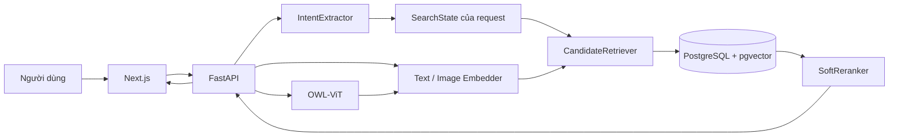
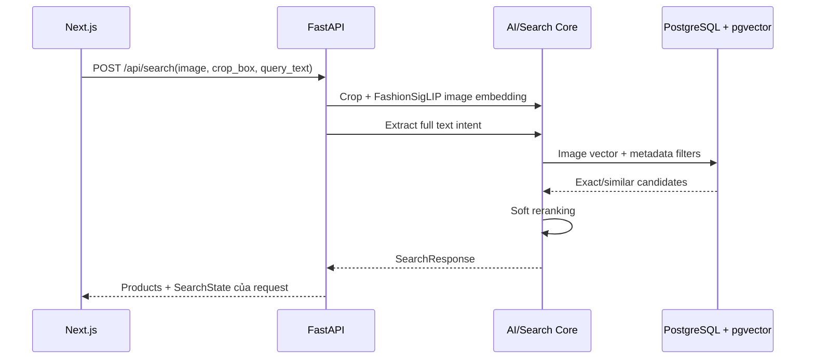

# Kiến trúc ứng dụng

Hệ thống dùng monorepo gồm Next.js frontend, FastAPI backend và PostgreSQL/pgvector. Mỗi lần gọi `/api/search` là một request độc lập; backend không lưu session tìm kiếm hoặc kế thừa điều kiện từ request trước.

## Các tầng chính

### Frontend

- `web/src/app/page.tsx`: điều phối state giao diện và các request độc lập.
- `web/src/components/SearchBar.tsx`: text, voice và image input.
- `web/src/components/ObjectSelectModal.tsx`: chọn vùng vật thể trong ảnh.
- `web/src/components/FacetSidebar.tsx`: category, màu và giá. Khi thay đổi, frontend gửi toàn bộ bộ lọc đang chọn trong một request mới.
- `web/src/components/ProductGrid.tsx`: hiển thị exact/similar results.
- `web/src/lib/api.ts`: REST client.

### API

- `POST /api/detect`: phát hiện bounding box.
- `POST /api/transcribe`: chuyển audio tiếng Việt thành text.
- `POST /api/search`: text, voice, image, image + text hoặc product reference.
- `GET /api/products/{id}`: chi tiết sản phẩm.

### Core services

- `extractor.py`: LLM intent extraction và backend reconciliation.
- `normalizer.py`: taxonomy, màu, giá, chất liệu và từ đồng nghĩa.
- `detector.py`: OWL-ViT và crop ảnh.
- `embedder.py`: FashionSigLIP cho ảnh, OpenAI embedding cho text.
- `retriever.py`: hard filter và pgvector retrieval.
- `reranker.py`: tính điểm đa tín hiệu.
- `search_audit.py`: ghi từng request và kết quả vào database.

### Persistence

PostgreSQL lưu catalog, hai cột vector 768 chiều và lịch sử từng search request. Backend không có dictionary session trong RAM. `SearchState` chỉ mô tả các điều kiện của request hiện tại.

## Luồng image + text

Khi có ảnh, vector ảnh quyết định độ tương đồng. Text trong cùng request cung cấp category cụ thể, màu, giá, chất liệu, style và điều kiện loại trừ. Hệ thống không cộng trực tiếp text vector với image vector.
