# Quản Lý Vòng Đời Trạng Thái Tìm Kiếm (Conversational State Lifecycle)

Tài liệu này thuyết minh chi tiết cách module `backend/core/state_manager.py` quản lý vòng đời của đối tượng `SearchState`, cơ chế hội thoại đa lượt (*Multi-turn Conversational Refinement*), và thao tác gỡ bỏ bộ lọc động (*Real-time Constraint Chip Removal*).

---

## 1. Cấu Trúc Đối Tượng `SearchState`

Đối tượng `SearchState` là trung tâm lưu giữ toàn bộ ngữ cảnh tìm kiếm của người dùng trong một phiên làm việc (`session_id`). Được định nghĩa bằng Pydantic trong `backend/schemas/state.py`:

| Trường dữ liệu | Kiểu dữ liệu | Ý nghĩa nghiệp vụ |
|---|---|---|
| `session_id` | `str` (UUID) | Định danh phiên làm việc độc nhất của người dùng |
| `turn_index` | `int` | Số thứ tự lượt tương tác hiện tại (bắt đầu từ 1) |
| `gender` | `Optional[str]` | Giới tính sản phẩm (`"Ladieswear"`, `"Menswear"`, `"Unisex"`) |
| `category` | `Optional[str]` | Nhóm danh mục trang phục (`"Garment Upper body"`, `"Shoes"`...) |
| `sub_category` | `Optional[str]` | Danh mục con cụ thể (`"T-shirt"`, `"Sneakers"`, `"Blazer"`...) |
| `color` | `Optional[str]` | Tên màu sắc chuẩn hóa (`"White"`, `"Black"`, `"Dark Blue"`...) |
| `max_price` | `Optional[int]` | Ngưỡng giá tiền tối đa tính theo đơn vị VND |
| `min_price` | `Optional[int]` | Ngưỡng giá tiền tối thiểu tính theo đơn vị VND |
| `style` | `Optional[str]` | Phong cách hoặc mục đích sử dụng (`"casual"`, `"office"`, `"party"`) |
| `materials` | `List[str]` | Danh sách chất liệu mong muốn (`["cotton", "denim"]`) |
| `exclude_materials` | `List[str]` | Danh sách chất liệu hoặc đặc điểm loại trừ (`["leather", "fleece"]`) |
| `reference_article_id` | `Optional[str]` | Mã sản phẩm được chọn làm gốc để tìm đồ tương tự |
| `active_chips` | `List[ConstraintChip]` | Danh sách thẻ bộ lọc đang hiển thị trên giao diện người dùng |

---

## 2. Chu Trình Hội Thoại Đa Lượt (Multi-Turn Refinement)

Hệ thống cho phép người dùng tinh chỉnh kết quả liên tục qua nhiều lượt tự nhiên mà không cần thiết lập lại từ đầu:

```mermaid
stateDiagram-v2
    [*] --> Turn1_InitialSearch : Khởi tạo tìm kiếm
    note right of Turn1_InitialSearch
      User: Upload ảnh outfit + chọn áo sơ mi trắng
      State: category="Shirt", color="White", turn=1
    end note

    Turn1_InitialSearch --> Turn2_PriceConstraint : Tinh chỉnh ngân sách
    note right of Turn2_PriceConstraint
      User nói: "Tìm cái dưới 500 ngàn"
      Merge: Giữ category="Shirt", color="White"; Thêm max_price=500000, turn=2
    end note

    Turn2_PriceConstraint --> Turn3_ColorChange : Đổi thuộc tính
    note right of Turn3_ColorChange
      User gõ: "Đổi sang màu đen dạ tiệc"
      Merge: Ghi đè color="Black", Thêm style="party", turn=3
    end note

    Turn3_ColorChange --> Turn4_ChipRemoval : Gỡ bộ lọc bằng UI
    note right of Turn4_ChipRemoval
      User click [✕] trên chip "Giá ≤ 500k"
      Action: max_price = None, Xếp hạng lại kết quả ngay lập tức
    end note

    Turn4_ChipRemoval --> [*]
```



### Nguyên tắc Hợp nhất Ý định (`StateManager.merge_intent`):
1. **Bảo tồn tiêu chí cũ không xung đột**: Nếu lượt mới không đề cập đến một thuộc tính đã có, thuộc tính đó tiếp tục được giữ nguyên.
2. **Ghi đè khi có tiêu chí mới**: Nếu lượt mới chỉ định giá trị mới cho một thuộc tính (ví dụ: chuyển từ áo sơ mi sang áo khoác), giá trị mới sẽ thay thế giá trị cũ.
3. **Cộng dồn danh sách loại trừ**: Tiêu chí phủ định (*"không phải da"*, *"không lấy màu đỏ"*) được bổ sung vào danh sách `exclude_materials` hoặc danh sách cấm.
4. **Hỗ trợ từ ngữ thứ tự (Ordinals)**: Khi người dùng nói *"tìm đồ giống cái thứ hai"*, hệ thống tra cứu `previous_results[1]` để gán vào `reference_article_id`.

---

## 3. Cơ Chế Thẻ Bộ Lọc Tương Tác (Interactive Constraint Chips)

Để giao diện người dùng luôn phản ánh trung thực trạng thái tìm kiếm hiện tại, hàm `StateManager.generate_chips(state)` tự động sinh mảng `ConstraintChip`:

```json
[
  { "chip_id": "category:Garment Upper body", "label": "Loại: Áo", "chip_type": "category", "value": "Garment Upper body" },
  { "chip_id": "color:Black", "label": "Màu: Đen", "chip_type": "color", "value": "Black" },
  { "chip_id": "max_price:500000", "label": "Giá ≤ 500k", "chip_type": "price", "value": 500000 },
  { "chip_id": "exclude:leather", "label": "Bỏ qua: Da", "chip_type": "exclude", "value": "leather" }
]
```

### Luồng Gỡ bỏ Chip Thời Gian Thực:
Khi người dùng bấm vào biểu tượng `[✕]` của một chip trên thanh `StateChipsBar`:
1. Frontend gửi yêu cầu: `DELETE /api/search/{session_id}/constraint?chip_id=color:Black`.
2. Backend gọi `StateManager.remove_constraint(state, chip_id)`:
   - Nếu `chip_id` bắt đầu bằng `color:` $\rightarrow$ đặt `state.color = None`.
   - Nếu bắt đầu bằng `max_price:` $\rightarrow$ đặt `state.max_price = None`.
   - Nếu bắt đầu bằng `category:` $\rightarrow$ đặt `state.category = None`.
3. Hệ thống tái sử dụng lại `query_vector` đã lưu trong bộ nhớ đệm (`SESSION_QUERY_VECTORS[session_id]`), thực hiện lại truy vấn SQL mà **không cần chạy lại model embedding hay OCR**, trả về kết quả mới chỉ trong **15 mili-giây**.

---

## 4. Lưu Vết Kiểm Toán CSDL (Audit Trail Persistence)

Mỗi lượt tìm kiếm thành công đều được hàm `StateManager.persist_turn()` ghi lại vào CSDL PostgreSQL phục vụ thống kê phân tích và đánh giá chất lượng tìm kiếm:
- Bảng cha `search_query`: Ghi nhận `query_id`, `session_id`, `query_type`, độ trễ `latency_ms`, và chuỗi JSON ý định `extracted_intent`.
- Bảng con tương ứng (TPT):
  - `text_query`: Lưu nội dung câu chữ `query_text`.
  - `image_query`: Lưu đường dẫn ảnh và tọa độ `selected_region`.
- Bảng `search_result`: Lưu top danh sách các sản phẩm hiển thị kèm điểm số tương đồng `similarity_score` và thứ hạng `rank_order`.
