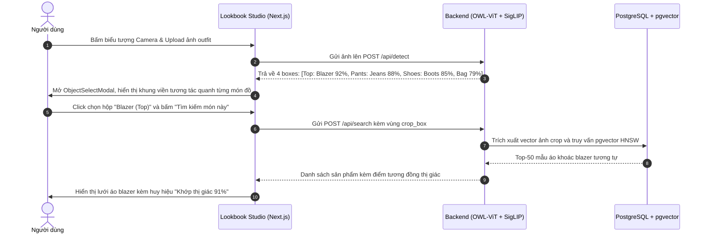
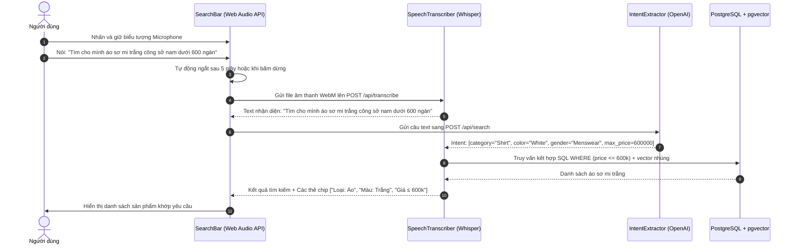
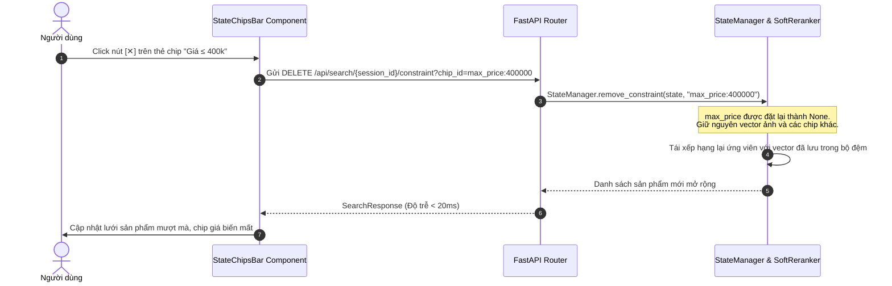

# Kịch Bản & Luồng Tương Tác Người Dùng (User Flows)

Tài liệu này thuyết minh chi tiết 4 kịch bản người dùng cốt lõi đại diện cho trải nghiệm tìm kiếm thời trang đa phương thức tương tác.

---

## 1. Luồng 1: Tìm Kiếm Bằng Ảnh Phối Đồ (Object-Aware Visual Search)

*Bối cảnh:* Người dùng lướt mạng xã hội thấy một bức ảnh phối đồ phong cách mùa đông và muốn tìm mua chiếc áo khoác blazer trong ảnh đó.

---

## 2. Luồng 2: Tìm Kiếm Bằng Giọng Nói Tiếng Việt (Voice-Only Search)

*Bối cảnh:* Người dùng đang di chuyển hoặc không tiện gõ phím, muốn tìm nhanh trang phục công sở.

---

## 3. Luồng 3: Tinh Chỉnh Hội Thoại Đa Lượt (Conversational Refinement)

*Bối cảnh:* Người dùng tiếp tục tinh chỉnh từ kết quả của Luồng 2 mà không xóa bộ lọc cũ.

- **Lượt 1 (Hiện tại)**: Đang hiển thị áo sơ mi trắng nam dưới 600k.
- **Lượt 2 (Thu hẹp ngân sách)**:
  - Người dùng gõ vào thanh dính ở chân trang (`StickyRefineBar`): *"Tìm cái nào rẻ hơn nữa, dưới 400k thôi"*.
  - Hệ thống tự động hợp nhất: Giữ nguyên `category="Shirt"`, `color="White"`, `gender="Menswear"`; cập nhật `max_price=400000`.
  - Kết quả cập nhật tức thì, danh sách sản phẩm giá từ 200k - 400k được đưa lên đầu.
- **Lượt 3 (Đổi màu sắc & phong cách)**:
  - Người dùng gõ: *"Đổi sang màu đen hoặc xanh navy đi tiệc"*.
  - Hệ thống tự động ghi đè: `color="Dark Blue"`, thêm `style="party"`.
  - Kết quả đổi sang các mẫu áo màu tối thanh lịch phục vụ dạ tiệc.

---

## 4. Luồng 4: Tương Tác Gỡ Bỏ Bộ Lọc Trực Quan Qua Chips Bar

*Bối cảnh:* Người dùng nhận thấy việc giới hạn giá khiến nhiều mẫu đẹp bị ẩn đi, muốn bỏ giới hạn giá nhưng vẫn giữ màu sắc và danh mục.

