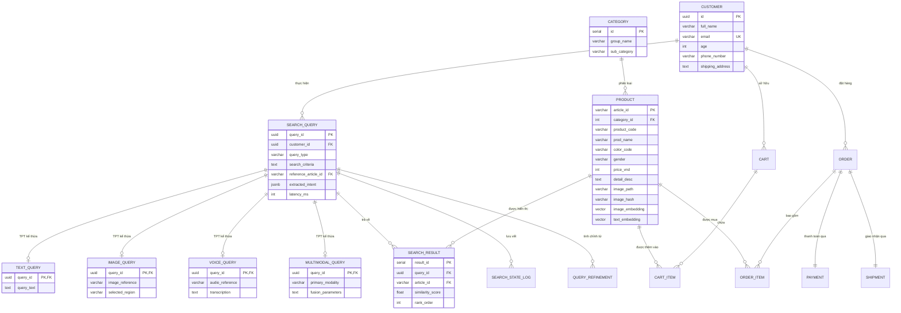

# Đặc Tả Cơ Sở Dữ Liệu PostgreSQL 16 & Mô Hình Kế Thừa 14 Bảng (TPT)

Tài liệu này đặc tả chi tiết kiến trúc CSDL PostgreSQL 16 kết hợp extension `pgvector`, sơ đồ thực thể quan hệ (ERD 3NF), mô hình kế thừa Table-Per-Type (TPT), và cấu hình các chỉ mục tìm kiếm vector cao chiều.

---

## 1. Sơ Đồ Thực Thể Quan Hệ (Mermaid ERD)

Toàn bộ CSDL được định nghĩa tại `backend/db/schema.sql` với 14 bảng quan hệ chuẩn hóa 3NF:



---

## 2. Mô Hình Kế Thừa Table-Per-Type (TPT Pattern)

Trong mô hình hướng đối tượng UML (Phân tích thiết kế hệ thống thông tin):
- Lớp cha trừu tượng `SearchQuery` chứa các thuộc tính dùng chung của một lượt truy vấn: `query_id`, `customer_id`, `query_type`, `extracted_intent` (JSONB), và `latency_ms`.
- Các lớp con kế thừa:
  1. `TextQuery`: Chuyên biệt cho truy vấn bằng câu chữ (`query_text`).
  2. `ImageQuery`: Chuyên biệt cho truy vấn bằng ảnh phối đồ (`image_reference`, `selected_region` toạ độ crop).
  3. `VoiceQuery`: Chuyên biệt cho truy vấn âm thanh (`audio_reference`, `transcription` chuỗi text sau khi Whisper dịch).
  4. `MultimodalQuery`: Chuyên biệt cho truy vấn hợp nhất đa phương tiện.

### Cơ chế ánh xạ sang CSDL quan hệ:
- Bảng con sử dụng trường `query_id` vừa đóng vai trò **Khóa chính (PRIMARY KEY)** vừa là **Khóa ngoại (FOREIGN KEY)** trỏ trực tiếp đến `search_query(query_id) ON DELETE CASCADE`.
- Khi xóa một truy vấn cha, toàn bộ dữ liệu ở bảng con tương ứng tự động được xóa sạch, đảm bảo tính toàn vẹn dữ liệu tuyệt đối.

---

## 3. Cấu Hình pgvector & Chỉ Mục HNSW

### 3.1. Khai báo cột Vector 768 chiều
Bảng `product` tích hợp trực tiếp 2 trường vector đặc trưng:
```sql
CREATE EXTENSION IF NOT EXISTS "vector";

ALTER TABLE product 
ADD COLUMN image_embedding vector(768),
ADD COLUMN text_embedding vector(768);
```

### 3.2. Cấu hình chỉ mục HNSW (Hierarchical Navigable Small World)
Chỉ mục HNSW được khởi tạo với tham số tối ưu hóa cho tập dữ liệu 5.000 sản phẩm:
```sql
CREATE INDEX IF NOT EXISTS idx_product_image_vector 
ON product USING hnsw (image_embedding vector_cosine_ops)
WITH (m = 16, ef_construction = 64);

CREATE INDEX IF NOT EXISTS idx_product_text_vector 
ON product USING hnsw (text_embedding vector_cosine_ops)
WITH (m = 16, ef_construction = 64);
```
- `m = 16`: Số lượng liên kết tối đa của mỗi node trên đồ thị HNSW (cân bằng giữa dung lượng RAM chỉ mục và tốc độ duyệt).
- `ef_construction = 64`: Kích thước danh sách ứng viên động được đánh giá trong quá trình xây dựng chỉ mục (đảm bảo độ chính xác Recall@10 > 98%).

### 3.3. Các chỉ mục B-tree hỗ trợ lọc cứng (Hard Constraints)
Để tối ưu hóa câu lệnh lọc kết hợp SQL WHERE, hệ thống tạo thêm các chỉ mục B-tree trên các thuộc tính hay dùng:
```sql
CREATE INDEX IF NOT EXISTS idx_product_price ON product(price_vnd);
CREATE INDEX IF NOT EXISTS idx_product_gender ON product(gender);
CREATE INDEX IF NOT EXISTS idx_product_color ON product(color_code);
CREATE INDEX IF NOT EXISTS idx_product_category ON product(category_id);
```
Nhờ đó, các điều kiện lọc giá tiền (`price_vnd <= 500000`) và giới tính (`gender = 'Ladieswear'`) được lọc trước trên cây B-tree trong <2ms trước khi tính toán khoảng cách vector.
